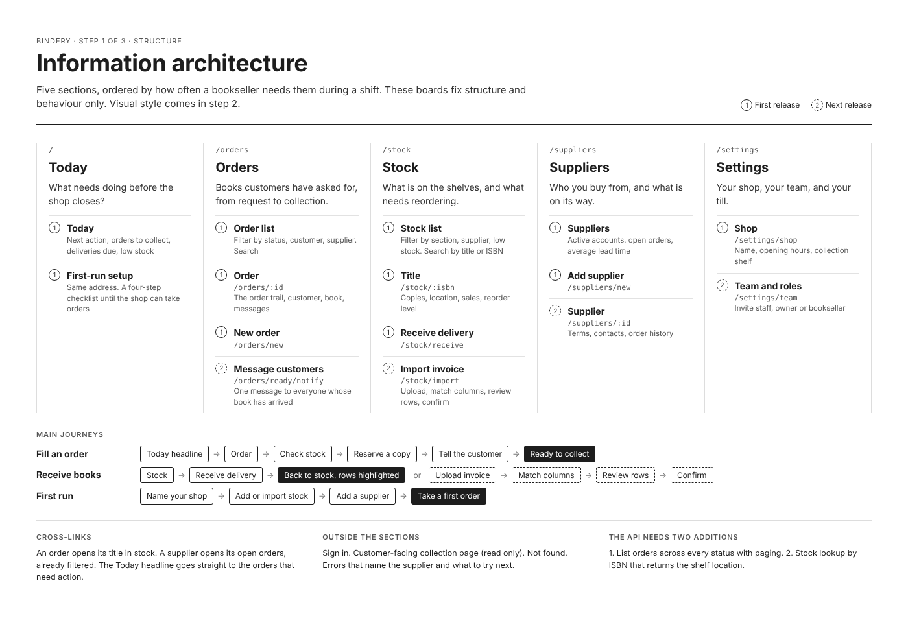

# ux-boards

A reusable template for documenting a product's UX before you build it: information architecture, navigation by screen size, wireframes, a visual system and styled screens. You describe the product in one YAML file and a small Python script renders print-ready boards as HTML, PDF and PNG.

**See it working:** [shazmoghaddam.github.io/ux-boards](https://shazmoghaddam.github.io/ux-boards/) shows the boards for two example products.

It started as the UX documentation for a product I'm building. The structure turned out to be the useful part, so this repo keeps the structure and swaps every project detail for placeholders.



## What you get

Every spec produces the same set of boards, in this order:

| Board | What it fixes |
| --- | --- |
| Information architecture | Sections ordered by how often people need them, every page with its route and release, the main journeys, cross-links and open questions |
| Navigation by screen size | Breakpoints chosen around real devices, and one answer per size for actions, tables, filters, detail views, forms and multi-step tasks |
| Wireframes | Phone, tablet and laptop frames in greyscale, built from simple blocks |
| Visual system | Colour tokens with their WCAG contrast ratios worked out for you, type scale, the one signature element, components and spacing tokens |
| Styled screens | The same wireframe blocks, rendered in your visual system |

The method behind the boards is written up in [docs/GUIDE.md](docs/GUIDE.md). It's worth reading even if you never run the script.

## Quick start

```bash
git clone https://github.com/ShazMoghaddam/ux-boards.git
cd ux-boards
python3 -m venv .venv && source .venv/bin/activate
pip install -r requirements.txt
playwright install chromium          # only needed for PDF and PNG export

# start your own spec from the template
python generator/generate.py init projects/my-product

# fill in every TODO, then check and build
python generator/generate.py check projects/my-product/spec.yaml
python generator/generate.py build projects/my-product/spec.yaml -o projects/my-product/out --pdf --png
open projects/my-product/out/index.html
```

`check` lists every placeholder you have not replaced yet and every text colour that fails WCAG AA. `build --strict` refuses to render until both lists are empty, which is handy in CI.

## Repo layout

```
ux-boards/
├── generator/
│   ├── generate.py            # init, check and build commands
│   └── templates/
│       ├── boards.html.j2     # board layouts and the block renderer
│       └── boards.css         # board chrome and frame styles
├── template/
│   └── spec.yaml              # the starter spec, every project detail is a TODO
├── examples/
│   ├── bindery/               # a fictional bookshop app, staff-facing
│   │   ├── spec.yaml
│   │   └── out/               # index.html, boards.pdf and one PNG per board
│   └── belaybook/             # a fictional climbing gym booking app, member-facing
│       ├── spec.yaml
│       └── out/
├── site/
│   └── index.html             # the landing page for the GitHub Pages demo
└── docs/
    ├── GUIDE.md               # the method: why each board exists and how to fill it in
    └── SPEC.md                # every key and block type the spec understands
```

## The examples

Two fully filled-in specs, chosen to be as different as possible so you can see the template isn't tied to one kind of product. Every name, number and person in them is invented.

| Example | What it is | Boards |
| --- | --- | --- |
| [Bindery](examples/bindery/spec.yaml) | Stock and customer orders for independent bookshops. Staff-facing, used at the counter and in the back office | [live](https://shazmoghaddam.github.io/ux-boards/bindery/) · [PDF](examples/bindery/out/boards.pdf) |
| [Belaybook](examples/belaybook/spec.yaml) | Class and session booking for climbing gym members. Customer-facing, used mostly on a phone | [live](https://shazmoghaddam.github.io/ux-boards/belaybook/) · [PDF](examples/belaybook/out/boards.pdf) |

The demo site is rebuilt from the specs on every push to `main` by `.github/workflows/pages.yml`. If you fork the repo and want your own demo, set **Settings → Pages → Source** to **GitHub Actions**.

## Adapting it

- **Content only:** copy `template/spec.yaml` and fill it in. Most people never need more.
- **New block types:** add a branch to the `block` macro in `boards.html.j2` and a style in `boards.css`. Blocks are plain YAML (`- button: Save`, plus options), so new ones slot in without touching the Python.
- **Different board size:** change `BOARD_W` and `BOARD_H` in `generate.py`. Frames rescale to fit automatically.
- **Your own fonts:** set `visual.type.import_url` and the two font stacks. If the fonts cannot load, system fonts are used.

## Requirements

Python 3.10 or newer, Jinja2 and PyYAML. Playwright with Chromium is optional and only used for PDF and PNG export; the HTML output works without it.

## Licence

[MIT](LICENSE). Use it for client work, change it, ship it in your own tools. Attribution is appreciated but not required beyond keeping the licence file.

Fonts are not bundled. The examples load Literata, Source Sans 3, Fraunces and Inter from Google Fonts at render time, all under the SIL Open Font License, which allows embedding them in the PDFs you produce.

## Contributing

Issues and pull requests are welcome, especially new block types, more example projects in different domains, and accessibility fixes. Please keep example content fictional.

## Author

Made by **Shaz Moghaddam**, a Python developer and data scientist in London.

[shazmoghaddam.github.io](https://shazmoghaddam.github.io/) · [GitHub](https://github.com/ShazMoghaddam) · [LinkedIn](https://www.linkedin.com/in/shazmoghaddam)
